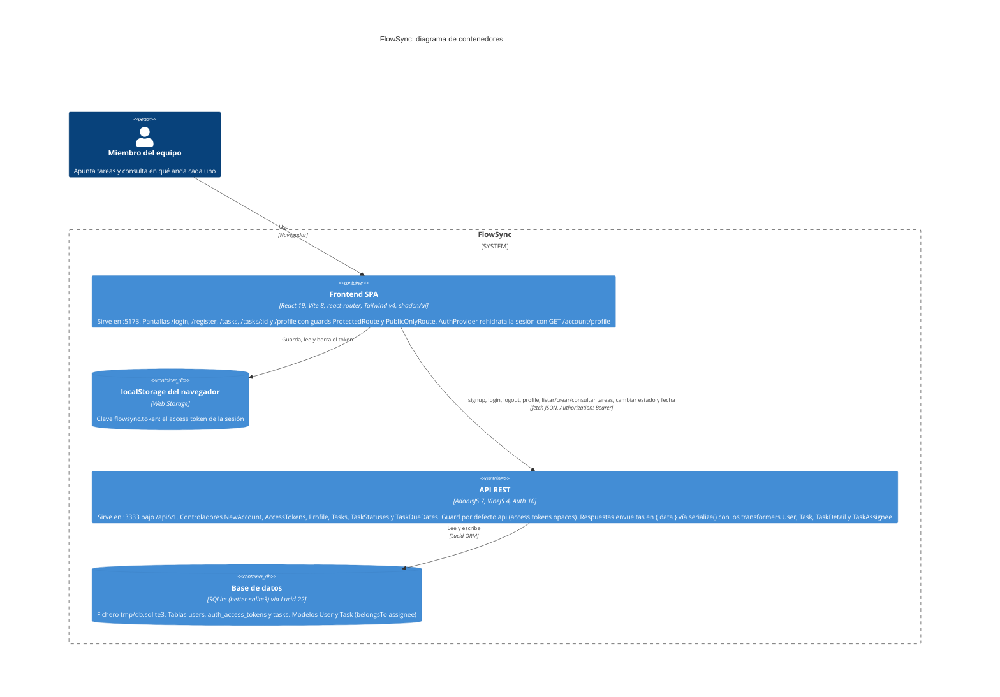

# Arquitectura de FlowSync

Diagrama de contenedores (estilo C4) de FlowSync tal y como está hoy en el código. Hay una SPA de React (`frontend/`) que guarda el token de sesión en `localStorage` y habla con el backend solo a través de `src/lib/api.ts`. El backend es una API AdonisJS (`backend/`) que expone `/api/v1/auth`, `/api/v1/account` y `/api/v1/tasks`, y persiste en un único fichero SQLite mediante Lucid. Las cajas resumen qué hay dentro de cada contenedor: pantallas, controladores, modelos, transformers y tablas. Todo sale de los ficheros del repo; no se dibuja nada que el código no tenga, como despliegues, colas o servicios externos.

